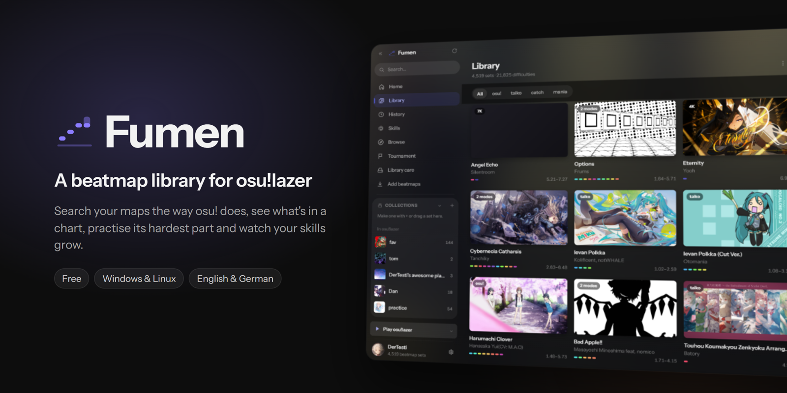
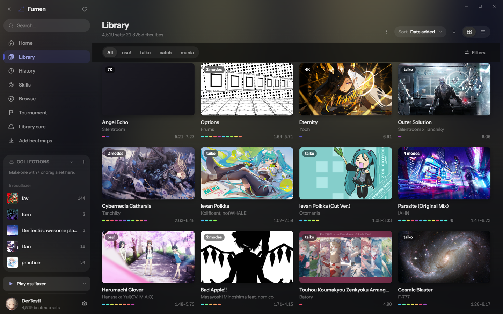
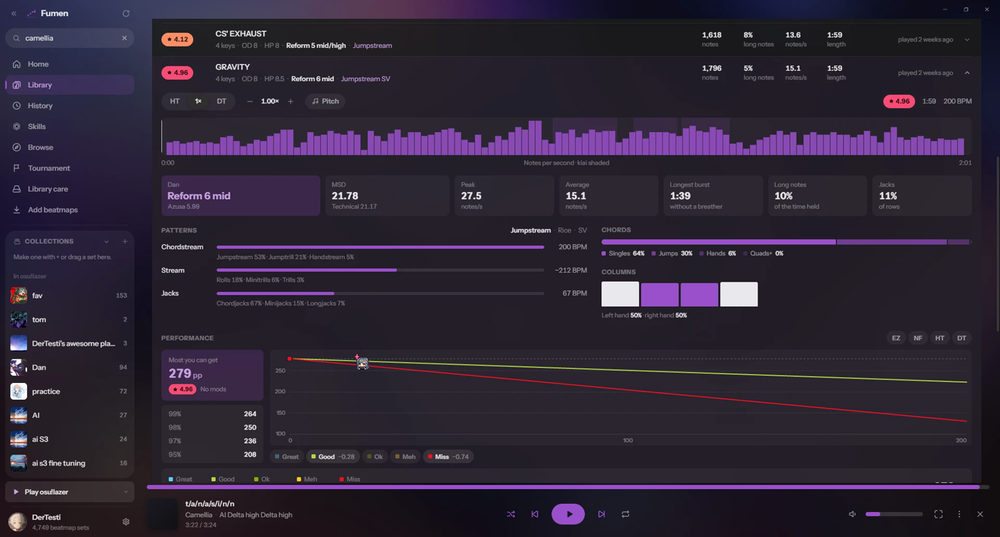
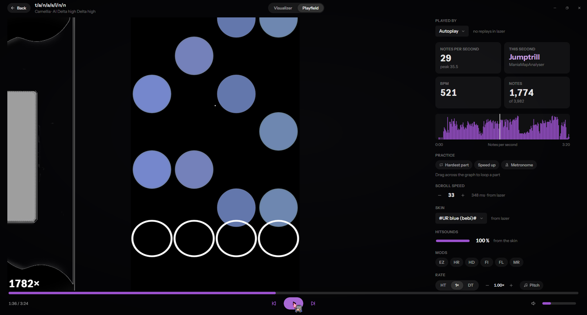
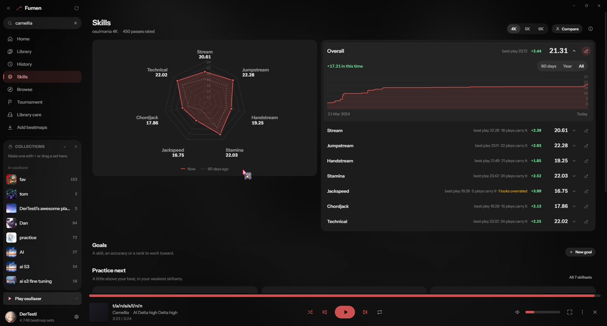

<p align="center">
  
</p>

<p align="center">
  <a href="https://github.com/DerTesti/fumen/releases/latest"></a>
  <a href="https://fumen.dertesti.dev"></a>
  <a href="https://fumen.dertesti.dev"></a>
  <a href="LICENSE"></a>
</p>

<p align="center">
  <a href="https://fumen.dertesti.dev/download/windows"></a>
  &nbsp;
  <a href="https://fumen.dertesti.dev/linux"></a>
</p>

<p align="center">
  <a href="https://fumen.dertesti.dev">Website</a> ·
  <a href="https://fumen.dertesti.dev/roadmap">Roadmap</a> ·
  <a href="https://github.com/DerTesti/fumen/releases">What's new</a> ·
  <a href="https://github.com/DerTesti/fumen/issues">Report a bug</a>
</p>

<br>

Fumen reads the library osu!lazer already has and gives you a better way through it: search like osu! does, see what's in every chart, practise the hard parts and follow how your skills grow. It never changes a thing in lazer behind its back.

> [!NOTE]
> Fumen is in **alpha**. Things change between versions and some may break. Issues are welcome.

<br>

<table>
  <tr>
    <td width="58%"></td>
    <td>
      <h3>Find any map in a second</h3>
      Search the way osu! does: <code>keys=7 sr>4.5 status=loved played=no</code>. Filters, star ranges and smart collections are a click away, and the list stays smooth at twenty thousand difficulties.
    </td>
  </tr>
  <tr>
    <td>
      <h3>Know a chart before you play it</h3>
      Every difficulty is read once: notes per second, the patterns in it, the hardest part, pp at any accuracy and, for osu!mania, an estimated dan and Etterna's MSD.
    </td>
    <td width="58%"></td>
  </tr>
  <tr>
    <td width="58%"></td>
    <td>
      <h3>Watch it, then practise it</h3>
      Any chart on the playfield at any rate, in your own lazer skin, for all four rulesets. Watch your replays with every judgement, or loop the hardest part with a metronome.
    </td>
  </tr>
  <tr>
    <td>
      <h3>Your skills, from your first pass to today</h3>
      Every osu!mania pass is rated the way Etterna does it, in seven skillsets. A graph shows how each one grew, goals keep you on track and practice picks the next maps for you.
    </td>
    <td width="58%"></td>
  </tr>
</table>

### And there's more

| | |
|---|---|
| **Add maps in bulk.** Paste every link from a pool, add every map you've played, or take everything a search on the mirrors finds. | **Collections everywhere.** Smart ones from a search, into osu!lazer, as a `collection.db`, or in the cloud for your other PCs. |
| **While you play.** A score page after every pass, live numbers through tosu, an OBS overlay and your heart rate. | **Scores in the cloud.** Your plays and replays from lazer and stable, safe on a new PC. Opt in, free. |
| **Your week.** Sittings, time played, the skills that moved and the goals that got closer. | **Tournaments.** Map pools, matches straight from mp links, player stats and a stream overlay. |
| **Library care.** Duplicates, broken files and what takes the space, deleted through lazer's own Delete. | **Your look.** Dark, OLED, Light and High contrast, in English or German. |

Everything else, in detail: [docs/FEATURES.md](docs/FEATURES.md).

<br>

## Is it safe for my osu!lazer?

Fumen reads lazer's data from a private copy of its database. It only writes into lazer when you add beatmap sets or send a collection there, and then:

- it uses **lazer's own import code**, so sets land exactly as if lazer had imported them,
- only while **lazer is closed**, and only on **lazer versions tested** with Fumen ([`lazer-compat.json`](lazer-compat.json)),
- after a **backup** of lazer's database (the last five are kept).

osu!stable is only read, unless you turn on imports into stable yourself (behind a warning).

## Requirements

- **Windows 10 or 11**, 64-bit, with **osu!lazer** on the same computer. Fumen finds its library by itself and updates itself.
- **Linux** is in testing: AppImage, `.deb` and a PKGBUILD for Arch on the [Linux page](https://fumen.dertesti.dev/linux).
- **macOS** comes later, once someone can test it.

<details>
<summary><b>Build it yourself</b></summary>

<br>

You need Node 22+, Rust (stable) and the .NET 8 SDK, on Windows (WebView2) or Linux.

```bash
npm install
npm run app          # builds the lazer helpers if needed, then starts `tauri dev`
```

| Script | What it does |
|---|---|
| `npm run sidecar` | rebuild the .NET helpers (lazer's database reader and importer) |
| `npm run verify-lazer` | test the import against the installed lazer and list its version |
| `npm run typecheck` | TypeScript checks |
| `npm test` | UI and Rust tests |
| `npm run dev:browser` | the UI in a normal browser, with Tauri shimmed |
| `npm run tauri build` | the installer only |

A build you make yourself works fully, but it can't use fumen.dertesti.dev (osu! login and the cloud): the site only answers Fumen's own builds. Map downloads go straight to the mirrors and work either way.

```
src/              UI (TypeScript, no framework)
src-tauri/        Rust: library cache, import, chart analysis, playfield, online features
sidecar/          .NET helpers that read lazer's database and import with lazer's own code
docs/PLAN.md      the roadmap in detail
```

</details>

<details>
<summary><b>What Fumen sends, and to whom</b></summary>

<br>

- **A start ping** to fumen.dertesti.dev: a random id made on your PC and the version, to count how many people use Fumen. The first start asks first, and Settings › About turns it off.
- **Online features** (osu! login, map downloads from community mirrors, cloud) only after you accept their terms. Without them everything else works the same.
- **Your osu! login** goes through fumen.dertesti.dev, because osu! only hands out tokens for an app's secret. The tokens stay on your PC (on Windows sealed so only your Windows user can read them).

Details in the [privacy policy](https://fumen.dertesti.dev/privacy).

</details>

## Credits

Fumen stands on a lot of great work, all under MIT:
[osu!](https://github.com/ppy/osu) and [osu-framework](https://github.com/ppy/osu-framework) (ppy) for the ports of lazer's calculators, playfields and skins,
[Etterna](https://github.com/etternagame/etterna)'s MinaCalc for MSD,
[rosu-pp](https://github.com/MaxOhn/rosu-pp) (through [rosu-pp-gemini](https://github.com/Raregendary/rosu-pp-gemini)) for star ratings and pp,
[ManiaMapAnalyser](https://github.com/LeoBlackMT/osumania_map_analyser) for patterns and dans,
[mania-tracker](https://github.com/aleju03/mania-hub) for the vibro detection,
and the mirrors [osu.direct](https://osu.direct), [nekoha.moe](https://mirror.nekoha.moe), [catboy.best](https://catboy.best), [beatconnect.io](https://beatconnect.io), [sayobot.cn](https://osu.sayobot.cn) and [nerinyan.moe](https://nerinyan.moe).
The full list is in [THIRD_PARTY.md](THIRD_PARTY.md).

## Licence

Fumen is free software under the [GPL-3.0 or later](LICENSE): use it, change it and pass it on, as long as what you pass on stays under the same licence. Parts from other projects keep their own licences ([LICENSES](LICENSES)). A fork is welcome, under another name.

<sub>Fumen (譜面, "chart" in rhythm game slang) isn't made by or affiliated with ppy or osu!.</sub>
